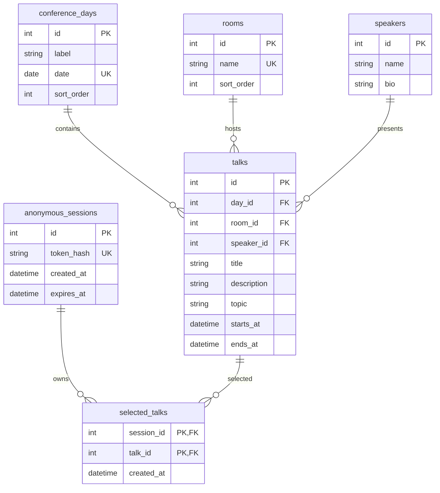
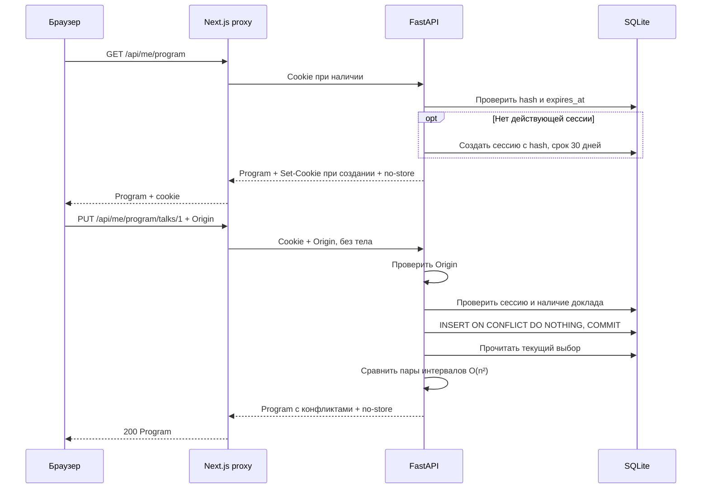

# Архитектура MVP

HTTP и зависимости — `app/api`; конфигурация и сборка приложения — `config.py`, `main.py`; ORM и соединения — `models.py`, `db.py`; сессии, выбор и конфликты — отдельные сервисы. Каталог не имеет публичных методов записи.

Все поля NOT NULL. Составной PK исключает дубликаты выбора, удаление сессии/доклада каскадирует выбор. Индексы покрывают FK (session_id — левый префикс PK) и starts_at. CHECK запрещает неположительную длительность. SQLite хранит naive UTC, TypeDecorator восстанавливает aware UTC; ORM-записи проверяют соответствие дня Москве. Seed валидирует день при формировании данных.

Транзакции запускаются явно. Read-транзакции проверки завершаются перед записью для предотвращения гонки повышения SQLite-блокировки. Вставка выбора атомарна и защищена уникальным ограничением; busy_timeout — 5000 мс. Read программы получает единый снимок списка. Приложение не создаёт схему на старте.

Технические справочники: [SQLAlchemy SQLite](https://docs.sqlalchemy.org/en/20/dialects/sqlite.html), [FastAPI error handlers](https://fastapi.tiangolo.com/tutorial/handling-errors/).
